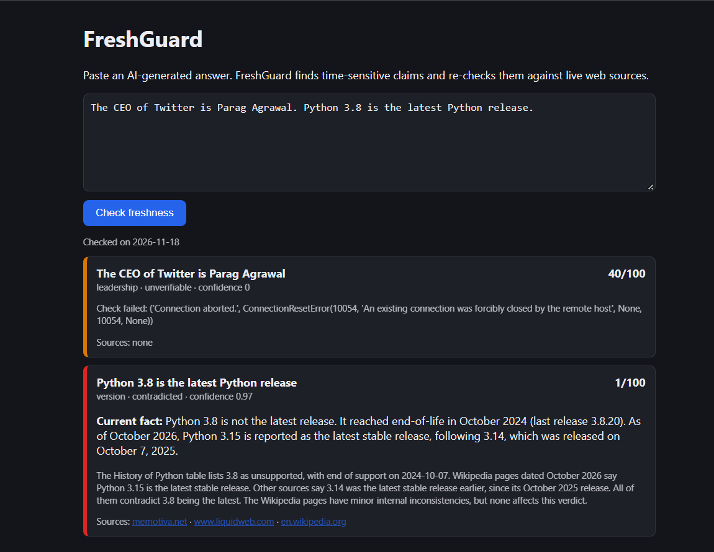
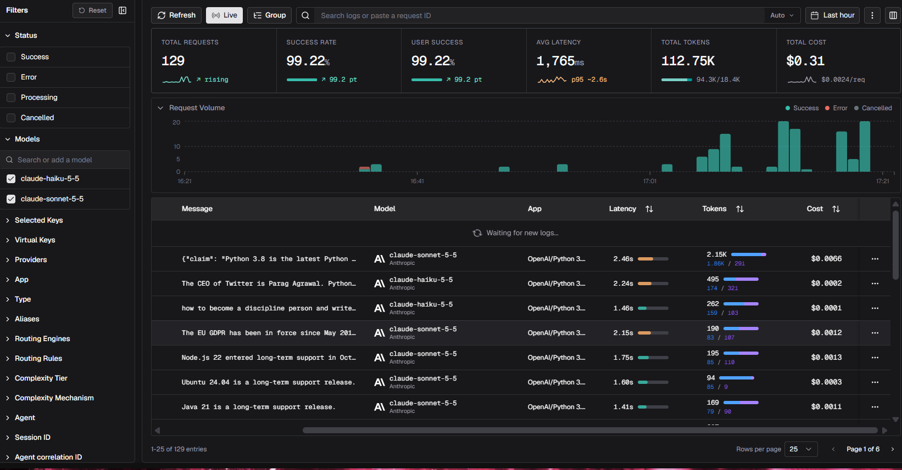
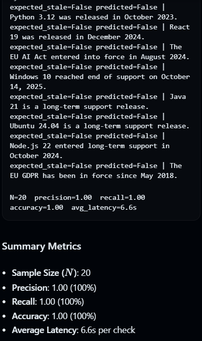

# FreshGuard: Stale-Answer Detector for AI Applications

FreshGuard is a fact-checking layer designed to sit alongside your LLM gateway to detect outdated, contradicted, or stale information in AI-generated answers.

Large Language Models answer with high confidence, but their internal knowledge is frozen at training cutoff. As real-world facts change—software releases move on, corporate leadership changes, laws are enacted, and prices fluctuate—AI answers can quickly become stale. FreshGuard identifies time-sensitive factual claims, verifies them against live web evidence, calculates an explainable freshness score (0–100), and provides corrected facts with source links.



---

## How It Works

```text
+-------------------------------------------------------+
|               Input Text / AI Response                |
+-------------------------------------------------------+
                           |
                           v
+-------------------------------------------------------+
| 1. Claim Extraction (Claude Haiku via Bifrost)        |
|    Finds volatile facts & formulates search queries   |
+-------------------------------------------------------+
                           |
                           v
+-------------------------------------------------------+
| 2. Live Web Retrieval (Tavily Search API)             |
|    Fetches clean snippets with dates when available   |
+-------------------------------------------------------+
                           |
                           v
+-------------------------------------------------------+
| 3. Evidence-First Judging (Claude Sonnet via Bifrost) |
|    Evaluates claims strictly against retrieved proof  |
+-------------------------------------------------------+
                           |
                           v
+-------------------------------------------------------+
| 4. Freshness Scoring & Output (FastAPI / Web UI)      |
|    Score (0-100), Verdict, Corrected Fact, Sources   |
+-------------------------------------------------------+
```

---

## How Tavily Is Used

Tavily provides live, search-engine-optimized web evidence retrieval tailored for LLMs:
- **Targeted Retrieval**: Gathers evidence using `search_depth="advanced"` based on queries generated dynamically during claim extraction.
- **Noise & Domain Filtering**: Uses `exclude_domains` to filter out forum and social media results (such as Reddit, Facebook, Quora, TikTok, Pinterest).
- **Evidence-First Prompt**: The judge model is instructed to evaluate each claim only against the snippets (with publication dates when available) and source URLs returned by Tavily.

---

## How Bifrost Is Used

Bifrost acts as a local OpenAI-compatible gateway (`http://localhost:8080/v1`) that handles all LLM interactions in the application:
- **Single OpenAI-Compatible Endpoint**: All model calls go through one endpoint (`llm = OpenAI(base_url=BIFROST_URL, api_key="not-needed")`).
- **Two Model Tiers**: Uses `anthropic/claude-haiku-5-5` for fast claim extraction and `anthropic/claude-sonnet-5-5` for evidence-based judging.
- **Provider Key Isolation**: The Anthropic provider API key stays private inside Bifrost; the application never holds or sees the provider key.
- **Request Logging**: Bifrost's dashboard logs all incoming requests, token counts, and model interactions.

The screenshot below shows the Bifrost dashboard during a live benchmark run — 129 requests logged, both model tiers visible, latency and cost per request tracked in real time.



---

## Windows Setup

### Prerequisites
- Python 3.11+
- Docker Desktop

### 1. Start Bifrost
a. Create a file named `bifrost.env` containing one line:
```env
BIFROST_SETUP_TOKEN=choose-any-local-secret-text
```
*(This file must NOT be committed; it is in `.gitignore`)*.

b. Run:
```powershell
docker run -d --name bifrost -p 8080:8080 --env-file bifrost.env -v ${PWD}/data:/app/data maximhq/bifrost
```

c. Open `http://localhost:8080`, paste the same setup token, and create an admin account (the password needs 12+ characters with upper and lower case, a number and a symbol).

d. In the dashboard add the Anthropic provider and paste your own Anthropic API key there (the key stays inside Bifrost).

e. In Security settings, make sure "Enforce Virtual Keys on Inference" is OFF (local development only; never expose this setup to the internet).

f. Note: if a model name is rejected, look at the model list in the Bifrost UI and use the names shown there in `.env`.

### 2. Set Up Virtual Environment
```powershell
python -m venv .venv
.\.venv\Scripts\activate
pip install -r requirements-dev.txt
```

### 3. Environment Configuration
Create your `.env` configuration (refer to `.env.example` for required variables):
```env
TAVILY_API_KEY=<your-tavily-api-key>
BIFROST_URL=http://localhost:8080/v1
EXTRACTOR_MODEL=anthropic/claude-haiku-5-5
JUDGE_MODEL=anthropic/claude-sonnet-5-5
```
*(Do not commit `.env` or expose API credentials in source control).*

### 4. Run the Application
```powershell
uvicorn main:app --port 8000 --reload
```
Open **`http://127.0.0.1:8000`** in your browser to interact with the FreshGuard dashboard, or **`http://127.0.0.1:8000/docs`** for interactive API documentation.

---

## Running Tests and Benchmarks

### Unit Tests
Verify test suites and endpoint mocks:
```powershell
pytest -q tests
```

### FreshGuard Benchmark
Evaluate FreshGuard with live Tavily retrieval and Bifrost:
```powershell
python benchmark.py benchmark_claims.json
```

### LLM-Only Baseline Benchmark
Run the baseline evaluation without search retrieval:
```powershell
python benchmark_baseline.py benchmark_claims.json
```

---

## Benchmark Results

> **Note on Sample Size**: The benchmark dataset is a small evaluation set consisting of **20 hand-labelled claims** (10 known stale facts, 10 known current facts).

Labels were assigned by the team.

| System | Precision | Recall | Accuracy | Notes |
| :--- | :---: | :---: | :---: | :--- |
| **FreshGuard (Tavily + Bifrost)** | **1.00** | **1.00** | **1.00** | Successfully detected all 10 stale claims with web citations. |
| **LLM-Only Baseline (No search)** | **1.00** | **0.80** | **0.90** | Missed 2 of 10 stale claims (IE11 support, Python 3.7 security updates). |

On this small set, adding live search raised recall from 0.80 to 1.00. Results depend on live web content and may vary between runs.

The screenshot below shows actual terminal output from `benchmark.py` on the 20-claim dataset:



---

## Limitations

- **Small Evaluation Set**: While the benchmark demonstrates a clear contrast between retrieval-augmented verification and static model knowledge, the 20-claim dataset is small. Wider domain-specific validation across hundreds of claims is recommended for production tuning.
- **Web Source Quality**: When primary sources disagree, are gated behind paywalls, or lack clear publication dates, evidence strength decreases.
- **Latency**: End-to-end verification performs sequential LLM extraction, one web search per claim, and evidence evaluation, resulting in a latency of several seconds per check.
- **Evidence-First Honesty**: When retrieved search evidence is insufficient or inconclusive, FreshGuard marks claims as `unverifiable` rather than speculating.
- **Future work**: integrate with a gateway semantic cache to flag stale cached answers.
