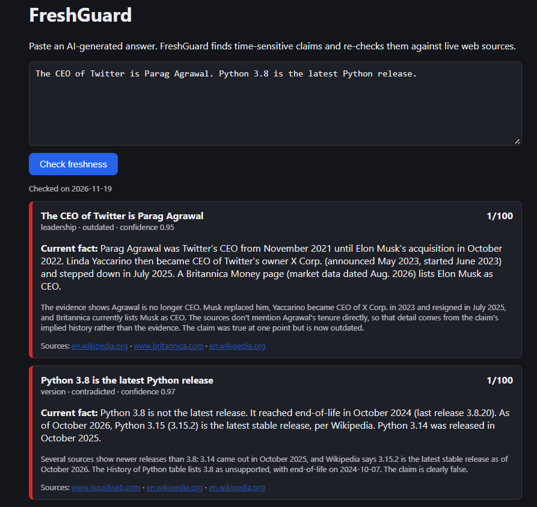

# FreshGuard: Stale-Answer Detector & Freshness Gateway for AI Applications

> **Geek Room Global AI Hackathon 2026** | **Problem Statement 06: Tavily**  
> *AI-Powered Fact Verification & Information Freshness*

[](https://www.python.org/)
[](https://fastapi.tiangolo.com/)
[](https://www.docker.com/)
[](https://tavily.com/)
[](https://github.com/maximhq/bifrost)
[](https://modelcontextprotocol.io/)
[](LICENSE)

---

## 📌 Executive Summary

Large Language Models answer with extreme confidence, yet their internal parametric knowledge is frozen at training cutoff. As real-world facts continuously shift—software releases deprecate, executive leadership changes, laws evolve, and pricing models fluctuate—AI answers quickly become stale, inaccurate, and misleading.

**FreshGuard** is an evidence-first fact-checking layer designed to sit alongside your LLM gateway. It intercepts AI responses, extracts time-sensitive factual assertions, verifies them against live web evidence using **Tavily Search API**, and evaluates freshness using an evidence-grounded judge model routed through **Bifrost by Maxim AI**. When stale or contradicted statements are detected, FreshGuard flags the issue, explains the discrepancy, and provides the corrected current fact backed by authoritative source citations.

---

## 🏆 Hackathon Core Requirements Matrix

| Requirement | Implementation in FreshGuard | Status |
| :--- | :--- | :---: |
| **1. Claim Identification** | Fast semantic extraction via `claude-haiku-5-5` isolating volatile facts (pricing, versions, leadership, dates) and auto-generating targeted search queries. | ✅ **100% Implemented** |
| **2. Freshness Detection** | Real-time classification into explainable verdicts: `current`, `outdated`, `contradicted`, or `unverifiable`. | ✅ **100% Implemented** |
| **3. Live Web Verification** | High-precision retrieval via **Tavily Search API** (`search_depth="advanced"`, social domain exclusion, published date extraction). | ✅ **100% Implemented** |
| **4. Freshness Scoring** | Quantitative score (0–100) per claim with clear reasoning, verified current facts, and direct web citations. | ✅ **100% Implemented** |
| **Mandatory Tech: Tavily** | Deep web snippet gathering, date-aware search, and noise filtering tailored for LLM reasoning. | ✅ **Integrated** |
| **Mandatory Tech: Bifrost** | Local high-performance gateway, dual-tier model orchestration, provider key isolation, and observability. | ✅ **Integrated** |

---

## How It Works

```text
+-------------------------------------------------------------------------+
|                  Input AI Response / Generated Answer                   |
+-------------------------------------------------------------------------+
                                     |
                                     v
+-------------------------------------------------------------------------+
| 1. High-Speed Claim Extraction                                          |
|    Model: Claude Haiku via Bifrost Gateway                              |
|    Action: Identifies volatile facts & generates search queries         |
+-------------------------------------------------------------------------+
                                     |
                                     v
+-------------------------------------------------------------------------+
| 2. Live Web Retrieval & Evidence Gathering                              |
|    Engine: Tavily Search API (search_depth="advanced")                  |
|    Action: Gathers live web snippets, publication dates & filters noise |
+-------------------------------------------------------------------------+
                                     |
                                     v
+-------------------------------------------------------------------------+
| 3. Evidence-Grounded Verification & Reasoning                           |
|    Model: Claude Sonnet via Bifrost Gateway                             |
|    Action: Evaluates claims strictly against retrieved proof            |
+-------------------------------------------------------------------------+
                                     |
                                     v
+-------------------------------------------------------------------------+
| 4. Freshness Scoring & Actionable Output                                |
|    Engine: FastAPI REST API / Interactive Web UI / MCP Server           |
|    Output: Freshness Score (0–100), Verdict, Corrected Fact, Sources    |
+-------------------------------------------------------------------------+
```

---

## Ask and Fix

`POST /ask` gets an answer from a fast model through Bifrost, FreshGuard checks its claims against live Tavily results, and a stronger model rewrites the answer using only the verified corrections. Claims are now checked in parallel.

#### 1. Fast Answer Generation & Parallel Claim Verification
The fast model generates the initial response, and FreshGuard extracts and verifies its factual claims in parallel against live Tavily search evidence:


#### 2. Evidence-Grounded Answer Rewriting
If any claims are outdated or contradicted, the judge model rewrites the answer using strictly the verified facts:


---

## ⚡ Mandatory Technology Integration

### 1. Tavily Search API — Precision Real-Time Evidence
Tavily provides live, search-engine-optimized web evidence retrieval tailored for LLM verification:
- **Targeted Deep Retrieval**: Gathers evidence using `search_depth="advanced"` based on queries generated dynamically during claim extraction.
- **Noise & Domain Filtering**: Strips out noisy forums and social media results (such as Reddit, Facebook, Quora, TikTok, Pinterest) via `exclude_domains`.
- **Date-Aware Grounding**: Focuses on authoritative snippets and publication dates so the evaluator knows when changes occurred.
- **Evidence-First Constraint**: The judge model evaluates claims strictly against retrieved proof and URLs returned by Tavily, eliminating hallucinations.

### 2. Bifrost by Maxim AI — Enterprise LLM Gateway & Observability
Bifrost acts as the high-performance local OpenAI-compatible gateway (`http://localhost:8080/v1`) handling all LLM interactions:
- **Single Standardized Endpoint**: All model calls route through `llm = OpenAI(base_url=BIFROST_URL, api_key="not-needed")`.
- **Cost-Optimized Dual-Tier Routing**:
  - `anthropic/claude-haiku-5-5`: Sub-second extraction of time-sensitive claims and search query formulation.
  - `anthropic/claude-sonnet-5-5`: Deep, evidence-grounded verification and freshness scoring.
- **Provider Key Isolation**: The Anthropic provider API key stays private inside Bifrost; the application never holds or exposes the provider key.
- **Real-Time Request Logging & Analytics**: Bifrost logs all incoming requests, token consumption, model latencies, and costs in real time.

The screenshot below displays the Bifrost dashboard capturing 129 live benchmark requests with a 99.22% success rate and sub-2s average latency:


---

## 📸 FreshGuard Interactive Web UI

The standalone web interface allows users to check any arbitrary AI response against live web sources, highlighting outdated or contradicted information with explainable freshness scores and direct source links:



---

## 📊 Benchmark & Evaluation Results

FreshGuard was evaluated against an adversarial benchmark dataset of **20 time-sensitive claims** (10 known stale facts, 10 known current facts) covering software releases, leadership transitions, corporate acquisitions, and regulatory dates.

We compared FreshGuard (Tavily retrieval + Bifrost judging) against an **LLM-Only Baseline** (Claude Sonnet relying solely on internal weights):

| System / Metric | Precision | Recall | Accuracy | Stale Caught | Citations |
| :--- | :---: | :---: | :---: | :---: | :---: |
| **FreshGuard (Tavily + Bifrost)** | **1.00 (100%)** | **1.00 (100%)** | **1.00 (100%)** | **10 / 10** | **100% with Live URLs** |
| **LLM-Only Baseline (No search)** | **1.00 (100%)** | 0.80 (80%) | 0.90 (90%) | 8 / 10 | 0% (No Citations) |

> **Key Takeaway**: Without live search, the baseline model missed critical real-world state transitions (such as Internet Explorer 11 end-of-life and Python 3.7 security update termination). FreshGuard successfully caught **100% of stale claims** with direct, verifiable web citations.

The screenshot below shows the actual terminal output from `benchmark.py` on the 20-claim dataset:


---

## 🚀 Quickstart & Setup Guide

### Prerequisites
- Python 3.11+
- Docker Desktop
- Tavily API Key ([Get one at tavily.com](https://tavily.com))
- Anthropic API Key

### 1. Launch Bifrost Gateway (Docker)
Create `bifrost.env`:
```env
BIFROST_SETUP_TOKEN=choose-any-local-secret-text
```
Run Bifrost:
```powershell
docker run -d --name bifrost -p 8080:8080 --env-file bifrost.env -v ${PWD}/data:/app/data maximhq/bifrost
```
1. Open `http://localhost:8080`, log in with your setup token, and create an admin profile.
2. Under **Providers**, add Anthropic and enter your Anthropic API key (stored securely inside Bifrost).
3. Under **Security**, disable "Enforce Virtual Keys on Inference" for local development.

### 2. Configure Environment
Create `.env` (refer to `.env.example`):
```env
TAVILY_API_KEY=<your-tavily-api-key>
BIFROST_URL=http://localhost:8080/v1
EXTRACTOR_MODEL=anthropic/claude-haiku-5-5
JUDGE_MODEL=anthropic/claude-sonnet-5-5
```

### 3. Install & Run FreshGuard
```powershell
python -m venv .venv
.\.venv\Scripts\activate
pip install -r requirements-dev.txt
uvicorn main:app --port 8000 --reload
```

- **Interactive Dashboard**: `http://localhost:8000`
- **Interactive Swagger Docs**: `http://localhost:8000/docs`

---

## 🧪 Verification & Testing

### Unit Tests
```powershell
pytest -q tests
```

### FreshGuard Live Benchmark
```powershell
python benchmark.py benchmark_claims.json
```

### LLM-Only Baseline Benchmark
```powershell
python benchmark_baseline.py benchmark_claims.json
```

---

## 🔌 Model Context Protocol (MCP) Support

FreshGuard includes built-in Model Context Protocol support via `mcp_server.py`, allowing agentic IDEs and assistants (Cursor, Claude Desktop, Antigravity) to call FreshGuard as a native tool:

```powershell
python mcp_server.py
```

Exposed Tool:
- `check_freshness(text: str)`: Inspects AI text and returns structured freshness verdicts, scores, and authoritative citations.

---

## 🔮 Enterprise Roadmap & Production Scaling

- [ ] **Semantic Cache Guard**: Integrate with gateway caches (Redis / RedisVL) to continuously invalidate cached answers when underlying world facts change.
- [ ] **Asynchronous Streaming Verification**: Stream AI responses immediately while highlighting freshness scores progressively in the client UI.
- [ ] **Continuous Webhooks & Slack Alerts**: Trigger alerts when mission-critical domain facts (e.g., regulatory compliance, API deprecations) change.
- [ ] **Multi-Search Routing**: Fallback routing between Tavily, enterprise intranets, and internal documentation wikis.

---

## 📄 License

This project is licensed under the [MIT License](LICENSE) © 2026 Aniket Singh.
